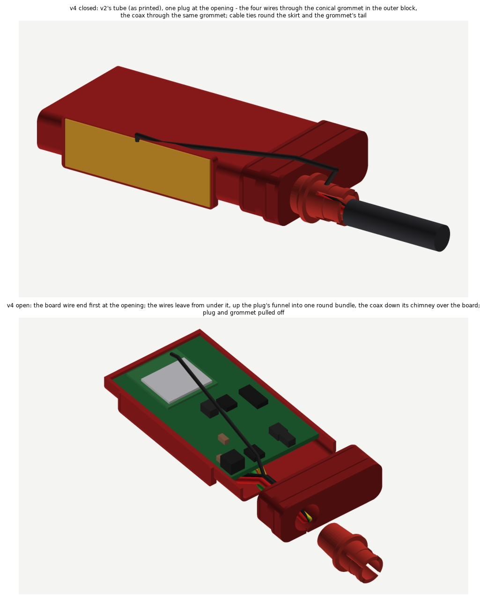
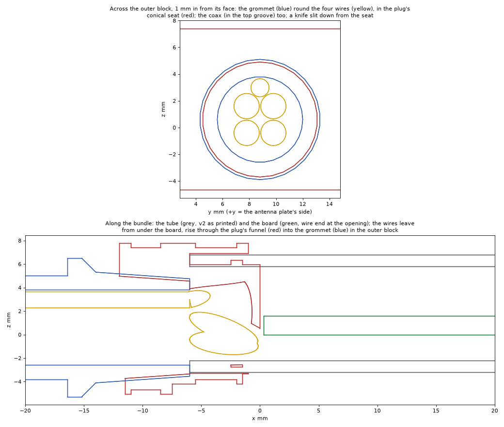

# TPU sleeve for the CANFD-MC board

A soft, printed enclosure for the [CANFD-MC](https://github.com/Prinsessen/canfd-mc-hardware) board (55 × 32 mm)
on a 2017 Indian Springfield. It replaces the heat shrink the board rode in: as flexible as the heat shrink, no
thicker, and it does not rattle with the vibrations as a hard ASA box would. Three parts in TPU 95A, one print job,
nothing to cut, two cable ties.





## The parts

| part | what it does |
|---|---|
| **tube** | the board's housing: open at one end, closed at the other, 1.0 mm wall. Two ledges carry the board's long edges; a flat plate on one side carries the WiFi antenna |
| **plug** | closes the open end: it goes 6 mm into the tube, a barb ring holds it there, a skirt grips the tube's end from outside (cable tie). Every cable leaves through one round hole in its outer block |
| **grommet** | a conical cable gland in that hole: the cone seals and centres the bundle, the tail (four fingers and a cable tie) grips it |

## Files

| file | what | print it |
|---|---|---|
| [`tpu_sleeve_all.stl`](tpu_sleeve_all.stl) | **everything in one job**: tube, plug and grommet side by side (13 × 102 mm, 63 mm high) | as the three below |
| [`tpu_sleeve.stl`](tpu_sleeve.stl) | the tube alone | standing on its open end |
| [`tpu_sleeve_plug_and_grommet.stl`](tpu_sleeve_plug_and_grommet.stl) | the plug and the grommet | plug on its flat outer face, grommet on its small end |
| [`tpu_sleeve_grommet.stl`](tpu_sleeve_grommet.stl) | a spare grommet | standing on its small end |
| [`tpu_sleeve.py`](tpu_sleeve.py) | the parametric model (CadQuery) that writes all four | |

## Printing

- **TPU 95A HF** (Bambu Lab's), fed from the **external spool**, not through an AMS.
- **Its own filament profile**: nozzle ~230 °C, bed 35 °C. A profile left on another material prints it wrong:
  one run on a PETG profile (255 °C / 70 °C) came out stringy, with loose threads hanging everywhere.
- No supports. **A brim** for the grommet: it stands 19 mm tall on a thin ring.
- Let the parts cool on the plate (TPU stretches while it is warm) and bend the plate to release them.
- Printed on a Bambu Lab P2S with a 0.4 mm nozzle; that printer prints these bores true to the model
  (5.0 printed 5.0, 6.4 printed 6.5).

## What else you need

- Two cable ties, 2.5 mm wide: one round the plug's skirt (about 95 mm round, so 150 mm or longer), one round the
  grommet's tail (25 mm round).
- The cables as drawn: **four wires of 0.5 mm², 2.0 mm outside**, and the antenna's **coax, 1.4 mm**, with a U.FL plug.
  Other sizes: change `WIRE_D`, `COAX_D` and `BORE` in the model.
- A flexible flat antenna, 41 × 12 mm, with its coax leaving the middle of a long edge (14 cm on ours).
- For the antenna's edges: a **flexible** clear coat (clear PU varnish, "liquid electrical tape" or clear Plasti Dip).
  Not a hard varnish (acrylic, nail varnish): the TPU flexes and it cracks.

## Fitting

The board goes into the tube **ESP32 end first**, so its wire end (pads CANL, CANH, GND, VBAT) is at the opening.
The cables are threaded through the grommet and the plug **before** the wires are soldered, so nothing is cut.

1. **The coax first:** its U.FL plug through the grommet, from the tail to the cone, then through the plug's hole from
   outside. Inside, the plug's chimney takes it up over the board's edge. Plug the U.FL onto the module.
2. **The four wires** the same way: through the grommet, through the plug; inside, the funnel takes them down under
   the board. Only the bare wires go through - a braid or sleeve over the bundle stops outside the grommet.
3. **Solder** the wires to the pads.
4. **Slide the board in**, ESP32 end first. It rests on the ledges.
5. **Push the plug into the tube** until the skirt covers the tube's end (the tube stretches over the barb ring).
   Cable tie in the skirt's groove.
6. **Push the grommet into the plug's seat**, cone first, until it stops. It stands about 2 mm proud before it is
   tight. Cable tie in the tail's groove: it squeezes the four fingers onto the bundle.
7. **The antenna** on the side plate: it has a shallow seat of exactly its size, so it goes on straight. Its own
   adhesive pad, then the flexible coat over its edges. The coax runs from the plug along the top to the antenna;
   coil any extra with the wires outside the sleeve.

**Taking it apart:** cut the two ties, pull the grommet back, pull the plug out. Nothing is worn.

## How it is built

- **Tube.** Inside 32.6 × 8.0 mm (0.3 mm from the board to each side wall), 63 mm long, 1.0 mm TPU wall - about
  what heat shrink is once shrunk. Outside 34.6 × 10.0 mm, 13 mm tall where the antenna plate is.
- **No rattle.** The board's long edges rest on two 1.0 mm ledges; the tallest part (the inductor L2, 4.0 mm) is
  0.2 mm under the roof - soft contact, as the heat shrink had. The plug stops it lengthwise.
- **Plug.** 0.3 mm over the tube's inside, a 0.4 mm barb ring 1.5 mm from its inner end, a 5 mm skirt over the tube's
  end with a 3.5 × 0.4 mm groove for the tie. Its outer block is 6 mm thick over the whole face, so it prints flat
  and the seat has wall round it. Inside, the cables meet in one round mouth: a **funnel** brings the wires from their
  flat row under the board (2.2 mm high) up into a round bundle over 6 mm, so no wire bends at the board's edge, and
  a 4 mm **chimney** takes the coax up over the edge (wide enough for the U.FL plug).
- **Seat and grommet.** The seat is a 4° cone, 6 mm long, 7.90 → 8.74 mm. The grommet is the same 4° cone, 8 mm
  long, 8.30 → 9.42 mm (0.2 mm a side over the seat), with a 45° chamfer under its collar (so it prints standing,
  without support), a 1.2 mm collar (11.8 mm) and a 9 mm tail: two slots right across at 45° and 135°
  (1.0 × 7 mm, printed open) make four fingers, and a 3.0 × 0.3 mm groove holds the tie.
- **The bore is 5.6 mm.** Four 2.0 mm wires roll round the 1.4 mm coax into a bundle 5.40 mm round: a bore that
  takes the bundle without force, a cone that seals, and a tie on the tail that grips (see below).
- **Antenna plate.** On the side away from L2 and the regulator, centred on the tube's length, with a 0.3 mm deep
  seat of the antenna's size + 0.4 mm (41.4 × 12.4). On the side, the antenna stands square to the board's copper
  instead of lying flat over it.

Part heights are the datasheets' (the board's BOM): L2 FNR5040S 4.0 mm, ESP32-S3-WROOM-1U 3.2 mm, L1 DLW43SH
2.7 mm, D2 SMB 2.3 mm. The wires' place across the opening (`WIRE_Y`, `FUNNEL_Y`, 3 - 14.6 mm) comes from the
board's KiCad file, not from a measurement; the funnel is 11.6 mm wide, so the wires have room to find their way.

## The model

```
pip install cadquery
python tpu_sleeve.py
```

writes the four STL files next to it and prints its checks: every part a valid single solid, the overlaps that must
be there (the plug in the tube, the grommet in its seat, the tail on the bundle) and the ones that must not (the
board in anything). Coordinates: the tube's opening at x = -6, the board from x = 0.3 (its wire end) to 55.3, y = 0
its centre line, z = 0 its underside.

## How it got here

- **v1** was a slit boot that had to be bent almost flat to let the 32 mm board in.
- **v2** split it in two: a tube open at one end, and an end plug with a hole per wire, slit to the rim. The tube
  has stayed as it is since. The plug's 1.3 mm holes sat right at the board's edge: every wire was bent back there,
  and the wires pushed the plug out.
- **v3** opened both ends with a plug at each, from a misunderstanding of where the wires leave. Never printed.
- **v4** (this one) takes everything out of one hole with a conical grommet, as a cable gland does - the board's
  owner's design. What the prints taught on the way:
  - **A nozzle on a thin cap cannot print.** The first plug had a round nozzle for the grommet on a 1.5 mm cap; it
    printed standing on the nozzle with the cap in the air, and failed. The whole outer face became a 6 mm block.
  - **The coax goes through the grommet too.** Its own slit in the plug weakened the plug too much.
  - **The bundle is 5.40 mm round, not 6.15.** Drawn as four wires in a square with the coax outside, the bore went
    4.6 (the fourth wire took 15 minutes), 5.0 (tight), 6.4 (loose - a fifth wire went through it), 6.2 (no
    different). The wires roll round the coax. 5.6 is the bore.
  - **A soft wedge in a soft seat does not grip.** With the grommet pushed home the cables still pulled out easily,
    at 6.4 and at 6.2: the TPU gives instead of squeezing. The tail with fingers and a tie - a connector's strain
    relief - does the gripping; the cone seals and centres.
  - **Nothing is cut.** Threading the cables before soldering means no slit anywhere. The model still has shallow
    knife lines and a tie groove on the outer block, for a bundle that cannot be threaded; with threaded cables they
    stay closed and that tie is not needed.

**Still to measure:** the WiFi signal before and after. Stuck straight on the board (0 mm from copper) the antenna
gave a daily mean of about -53 dBm at first and -66 to -71 dBm by mid-November 2026; the same place with the antenna
on the side plate will tell what the sleeve does.
